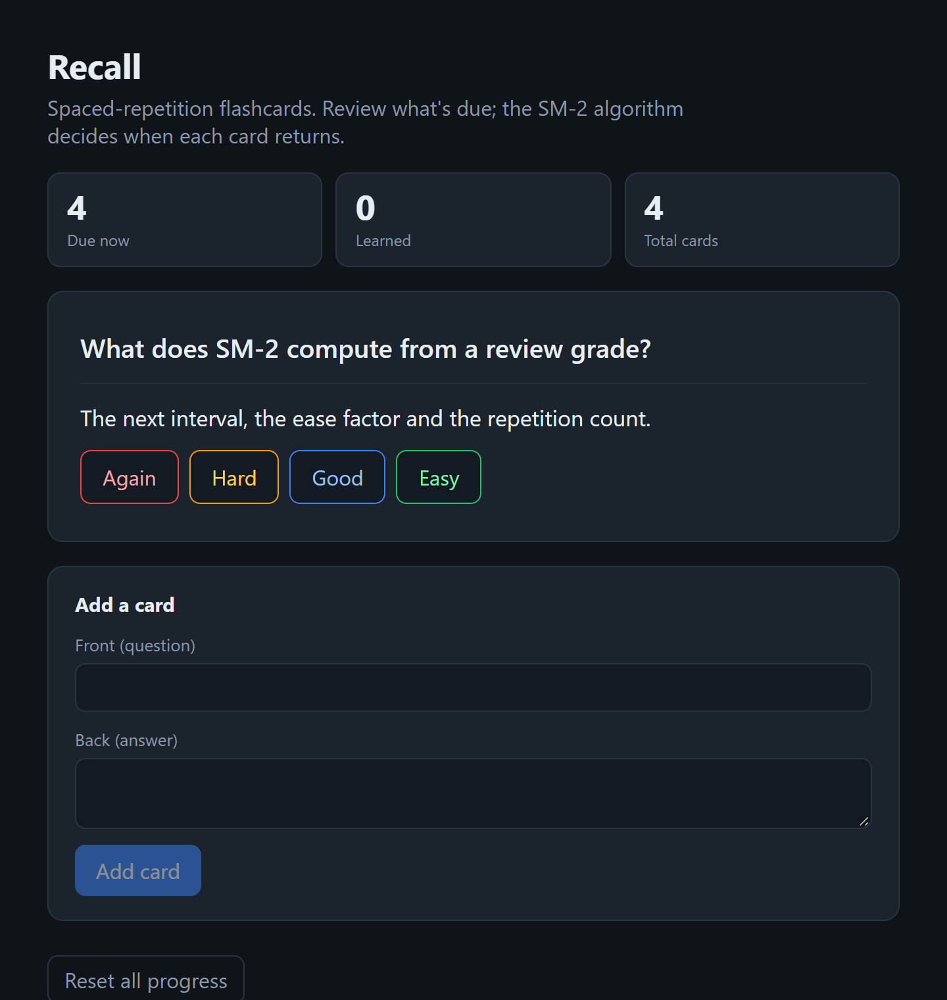

# Recall

[](https://github.com/BoogeyCodes/recall/actions/workflows/ci.yml)


A spaced-repetition flashcards app, built with Angular. Review the cards that are due; the **SM-2
algorithm** decides when each card should come back, so cards you know well return rarely and ones you
struggle with return soon.



## Why

Spaced repetition is the reason flashcard apps like Anki work: review timing is chosen so each card
comes up just as you are about to forget it. The scheduling is a small, elegant algorithm (SM-2), and
this project implements it properly as a pure, tested function and wires it into a clean Angular app —
standalone components, signals for state, and a service that persists the deck. It is deliberately
compact, so the algorithm and the Angular idioms are the visible parts.

## How scheduling works

After seeing a card's answer you grade your recall from **Again** (a lapse) to **Easy**. SM-2 turns
that grade into the next review date:

- Each card tracks a **repetition count**, an **interval** (days until next review), and an **ease
  factor** that stretches or compresses future intervals.
- A good grade advances the interval along `1 day → 6 days → interval × ease`, and nudges the ease
  factor up or down depending on how easy the recall was.
- A lapse (grade below 3) sends the card back to the start with a one-day interval, while still
  lowering its ease factor.
- The ease factor is floored at 1.3, so a troublesome card never spirals into daily reviews forever.

The algorithm lives in [`src/app/sm2.ts`](src/app/sm2.ts) as a pure function with no Angular
dependency, which is why it can be unit-tested exhaustively.

## Architecture

```
  sm2.ts            pure SM-2 scheduler: (state, grade, now) -> next schedule
      │ used by
      ▼
  DeckService       signals hold the deck; review() runs SM-2 and updates due dates;
      │             persisted to localStorage; `due` and `stats` are computed signals
      ▼
  components (standalone, OnPush, signal-driven)
    AppComponent    shell + stats
    ReviewComponent the current due card: reveal, then grade
    AddCardComponent a reactive form to add cards
```

Everything is reactive through Angular signals: reviewing a card updates the deck signal, and the
`due` and `stats` computed signals — and the UI — update automatically.

## Run it

```bash
npm install
npm start          # http://localhost:4200
npm run build      # production build in dist/
```

The deck is seeded with a few cards on first run and saved to `localStorage`, so your progress
survives a reload.

## Testing

```bash
npm test           # interactive, local Chrome
npm run test:ci    # headless, no-sandbox (used by CI)
```

Thirteen tests. The SM-2 scheduler is unit-tested in isolation: the `1 / 6 / interval × ease`
progression, ease-factor adjustment per grade, lapse handling, the 1.3 floor, and that an easy card
spaces out faster than a hard one. The `DeckService` is tested for seeding, adding, reviewing (a card
leaves the due set after a good grade, stays after a lapse) and resetting. The component is tested for
rendering. CI runs them in headless Chrome on every push.

## Project layout

```
src/app
├── sm2.ts                 the SM-2 algorithm (pure, framework-free)
├── sm2.spec.ts
├── models.ts              Card and DeckStats types
├── deck.service.ts        signal-based state + localStorage persistence
├── deck.service.spec.ts
├── review.component.ts    reveal-and-grade flow
├── add-card.component.ts  reactive add-card form
└── app.component.ts       shell and statistics
```

## Ideas for later

- Multiple decks and tags.
- An import/export of cards as JSON or CSV.
- A review history chart and a daily streak.

## License

MIT
